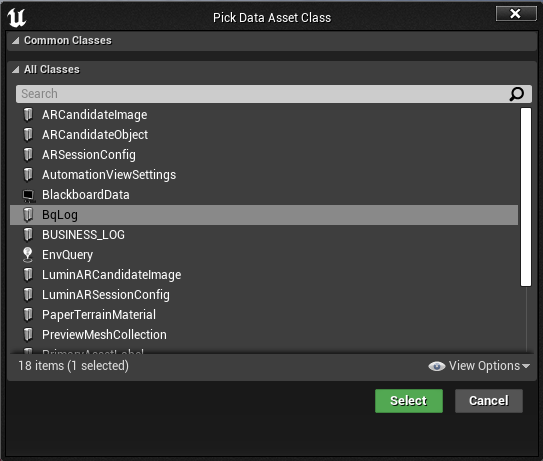
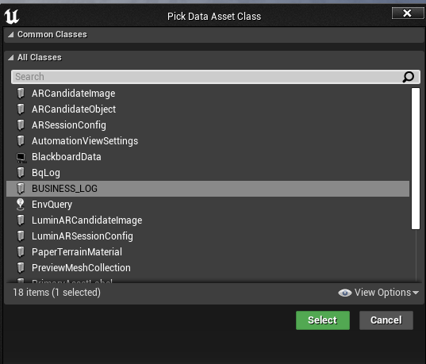
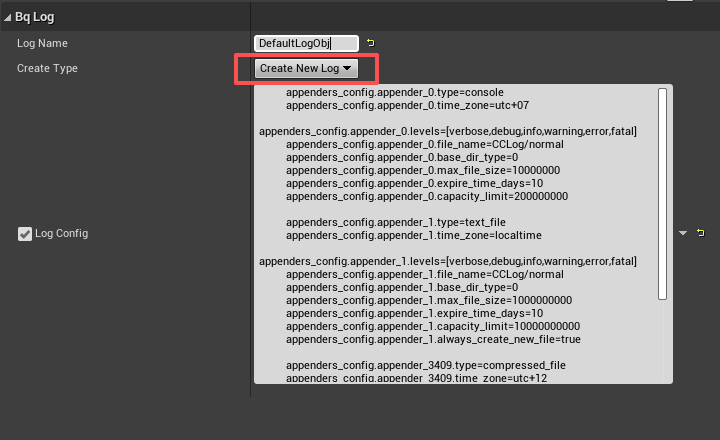
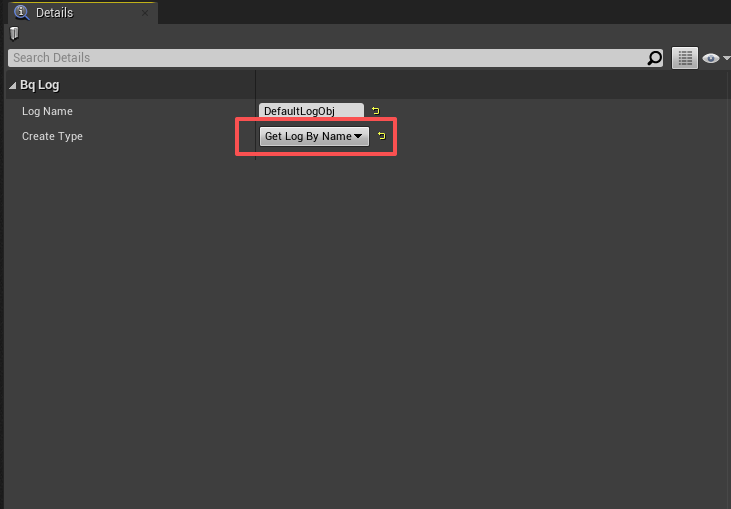
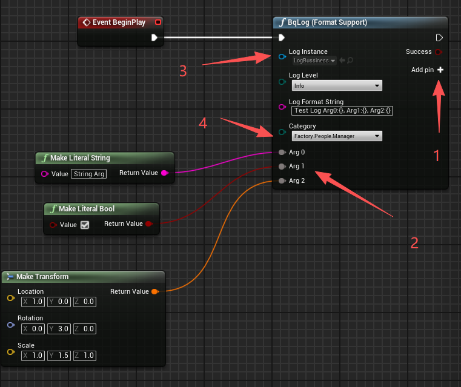

# 游戏引擎集成指南

[← 返回首页](../README_CHS.md) | [English](./ENGINE_INTEGRATION.md)

---

## Unity / 团结引擎

### 集成方式

- **Unity**
  - 从 [Releases 页面](https://github.com/Tencent/BqLog/releases)下载 `unity_package_{version}`；
  - 解压后在 Unity Package Manager 中选择「从 tarball 安装」，指向其中的 `.tar` 文件导入；
  - 官方 Unity 暂不支持鸿蒙，如需鸿蒙支持可按需自行集成。

- **团结引擎**
  - 从 [Releases 页面](https://github.com/Tencent/BqLog/releases)下载 `tuanjie_package_{version}`；
  - 解压后同样通过 Unity Package Manager 以 tarball 方式导入；
  - 与 Unity 的主要差异是已集成鸿蒙相关支持。

### 使用方式

导入后，使用 `bq.log` C# API：

```csharp
string config = @"
    appenders_config.console.type=console
    appenders_config.console.levels=[all]
";
var log = bq.log.create_log("cs_log", config);
log.info("Hello from Unity! value:{}", 42);
```

更多示例可参考仓库下的 `/demo/csharp` 目录。

---

## Unreal Engine

可任选以下一种方式集成。

### 支持的引擎版本

| 安装方式 | 支持的 Unreal Engine 版本 |
|---|---|
| **Fab** | UE 4.22 – 4.27 以及 UE 5.0 – 5.8（官方已提供的全部版本，每个次版本都有专用 zip） |
| **预编译版（GitHub Release）** | UE 4.25 – 4.27（`ue4` 包）、UE 5.0 – 5.8（`ue5` 包）与当前 UE6 开发版（`ue6` 包） |
| **源码版（GitHub Release）** | UE 4.25 – 4.27（`ue4` 包）、UE 5.0 – 5.8（`ue5` 包）与当前 UE6 开发版（`ue6` 包） |

> **使用 UE 4.22 / 4.23 / 4.24？** 请通过 [Fab](https://www.fab.com/listings/386d1c78-e164-4e97-8b3e-e88cbf9b6acf) 安装——Fab 上每个引擎次版本的专用 zip 针对这些老 UE4 的 `.uplugin` 语法差异做了适配（旧版 UBT 不识别 `UncookedOnly` 或 `LinuxAArch64` 等标识符）。GitHub Release 上的通用 `ue4` 包只针对 UE 4.25+。
>
> **UE 4.22 与 4.23 的 Mac / iOS 支持：** 由于 Fab 构建机的限制，Fab 上针对 UE 4.22 与 4.23 的 zip **未包含** Mac 与 iOS 版本。如果在这两个引擎版本下需要 Mac 或 iOS 支持，请前往 [GitHub Releases 页面](https://github.com/Tencent/BqLog/releases) 下载 **源码版** 或 **预编译版** 手动引入。
>
> **使用 UE6？** 请从 [GitHub Releases 页面](https://github.com/Tencent/BqLog/releases)手动下载 `ue6` 源码版或预编译版插件。包里有两个插件：`BqLog`，与 UE5 是同一份插件，加上 UE6 需要的代码分支；以及可选的 `BqLogVerse`，提供 Verse 接口（见[在 Verse 中使用 BqLog](#4在-verse-中使用-bqlogue6)）。两者都已在当前 UE6 开发版中验证可用。UE6 仍在开发，后续可能需要随引擎变化调整兼容性。由于 Epic 官方的 Fab 引擎支持目前只到 UE 5.8，Fab 暂时无法分发 UE6 插件。
>
> **PS4 / PS5 / Switch？** 请使用**源码版**：预编译版不含主机平台的库。主机平台宏由插件传入，两个 base dir 也由插件设置。平台相关准备见[接入指南 — 主机平台](./INTEGRATION_GUIDE_CHS.md#主机平台)。

### 集成方式

- **Fab（推荐）**
  - 通过 Epic Fab 商城直接安装：[BqLog on Fab](https://www.fab.com/listings/386d1c78-e164-4e97-8b3e-e88cbf9b6acf)；
  - 在 Epic Games Launcher / Fab 客户端中将插件添加到引擎，然后在工程中启用即可，无需手动下载解压；
  - 适合希望以最简方式安装并通过 Fab 自动获取更新的用户。

- **预编译版（Prebuilt）**
  - 从 [Releases 页面](https://github.com/Tencent/BqLog/releases)下载 `unreal_plugin_prebuilt_ue4_{version}`（UE 4.25 – 4.27）、`unreal_plugin_prebuilt_ue5_{version}`（UE 5.0 – 5.8）或 `unreal_plugin_prebuilt_ue6_{version}`（当前 UE6 开发版）；
  - 解压到游戏项目的 `Plugins` 目录下。

- **源码版（Source）**
  - 从 [Releases 页面](https://github.com/Tencent/BqLog/releases)下载 `unreal_plugin_sources_ue4_{version}`（UE 4.25 – 4.27）、`unreal_plugin_sources_ue5_{version}`（UE 5.0 – 5.8）或 `unreal_plugin_sources_ue6_{version}`（当前 UE6 开发版）；
  - 解压到游戏项目的 `Plugins` 目录下，由引擎进行二次编译。

解压后请确认插件描述文件位于以下路径。多嵌套一层 `BqLog` 目录会导致 Unreal 无法正确发现插件。

```text
<你的项目>/Plugins/BqLog/BqLog.uplugin
```

### 启用插件

在你的 `.uproject` 文件的 `Plugins` 节点下添加 BqLog：

```json
"Plugins": [
    {
        "Name": "BqLog",
        "Enabled": true
    }
]
```

> 如果 `.uproject` 已有 `Plugins` 数组，请把上述条目合并进去，不要再添加第二个 `Plugins` 键。项目 `Plugins` 目录中的插件通常会被自动发现，但仍建议显式声明 BqLog，便于版本管理和团队协作。不需要在 `.uproject` 的 `AdditionalDependencies` 中添加 BqLog。

### 添加 BqLog 模块依赖

每个需要包含 BqLog 头文件的游戏模块，都必须在自己的 `.Build.cs` 中添加 `"BqLog"`。如果只在 `.cpp` 文件中使用 BqLog，推荐添加为私有依赖：

```csharp
PrivateDependencyModuleNames.AddRange(new string[] {
    "BqLog"
});
```

如果模块的公共头文件暴露了 BqLog 类型或包含了 BqLog 头文件，则应改为公共依赖：

```csharp
PublicDependencyModuleNames.Add("BqLog");
```

之后即可在 C++ 中包含 Unreal 适配器：

```cpp
#include "BqLog.h"
```

> **在 Unreal Engine 中请包含 `"BqLog.h"`，不要用 `"bq_log/bq_log.h"`**——后者不包含 Unreal Engine 适配。**也不要**手动添加 include 目录，`BqLog` 模块会导出所需路径。蓝图节点模块 `BqLogBPNodes` 是编辑器专用模块，同样**不需要**加入依赖。修改 `.uproject` 或 `.Build.cs` 后，如果 IDE 没有自动刷新，请重新生成项目文件，再重新编译 Editor Target。

### 1）对 `FName` / `FString` / `FText` 的支持

在 Unreal 环境中，BqLog 内置了适配器：

- 自动支持 `FString`、`FName`、`FText` 作为 format 字符串和参数；
- 兼容 UE4、UE5 与当前 UE6 开发版。

示例：

```cpp
bq::log log_my = bq::log::create_log("AAA", config);   // config 省略

FString fstring_1 = TEXT("这是一个测试的FString{}");
FString fstring_2 = TEXT("这也是一个测试的FString");
log_my.error(fstring_1, fstring_2);

FText text1 = FText::FromString(TEXT("这是一个FText!"));
FName name1 = FName(TEXT("这是一个FName"));
log_my.error(fstring_1, text1);
log_my.error(fstring_1, name1);
```

如果希望自定义适配行为，也可以使用「方式2（全局函数）」自行定义 `bq_log_format_str_size` 和 `bq_log_format_str_chars`（详见 [高级用法](./ADVANCED_USAGE_CHS.md)）。

### 2）将 BqLog 的输出转接到 Unreal 日志窗口

Unreal 插件会自动将所有 BqLog 输出转接到 Unreal 的 Output Log，无需额外配置。

> **注意：** 如果未使用插件而是直接在 C++ 级别集成 BqLog，可以通过 `bq::log::register_console_callback` 手动将日志转发到 `UE_LOG`。详见 [高级用法](./ADVANCED_USAGE_CHS.md)。

### 3）在蓝图中使用 BqLog

已引入插件后，可在蓝图中直接调用 BqLog：

1. **创建日志 Data Asset**
   - 在 Unreal 工程中创建 Data Asset，类型选择 BqLog：
     - 默认 Log 类型（不带 Category）：
       
     - 若生成了带 Category 的日志类（详见 [高级用法 — Category](./ADVANCED_USAGE_CHS.md)），并将 `{category}.h` 与 `{category}_for_UE.h` 加入工程：
       

2. **配置日志参数**
   - 双击打开 Data Asset，配置日志对象名与创建方式：
     - `Create New Log`：在运行时新建一个 Log 对象：
       
     - `Get Log By Name`：仅获取其他地方已经创建的同名 Log：
       

3. **在蓝图中调用日志节点**

   

   - 区域 1：添加日志参数；
   - 区域 2：新增的日志参数节点，可通过右键菜单（Remove ArgX）删除；
   - 区域 3：选择日志对象（即刚才创建的 Data Asset）；
   - 区域 4：仅当日志对象带 Category 时显示，可选择日志 Category。

4. **测试**
   - 运行蓝图，如配置正确且有 ConsoleAppender 输出，可在 Log 窗口看到类似输出：

     ```text
     LogBqLog: Display: [Bussiness_Log_Obj] UTC+7 2025-11-27 14:49:19.381[tid-27732 ] [I] [Factory.People.Manager] Test Log Arg0:String Arg, Arg1:TRUE, Arg2:1.000000,0.000000,0.000000|2.999996,0.00[...]
     ```

### 4）在 Verse 中使用 BqLog（UE6）

`ue6` 包里还有一个 `BqLogVerse` 插件，把 BqLog 带到 Verse，接口和其他语言一致：名字沿用 C++（`bq.log` 对应 `bq::log`，`bq.create_log` 对应 `bq::log::create_log`），分类日志写作 `MyLog.info(MyLog.cat.Shop.Seller, "...")`。Verse 可以自己创建、配置日志，也可以使用 C++、蓝图或 BqLog Data Asset 创建的日志。它目前是实验性的，默认不启用，不用 Verse 的工程不受影响。

1. **启用插件**：让 `<你的项目>/Plugins/BqLogVerse/BqLogVerse.uplugin` 与 `Plugins/BqLog` 放在一起，并在 `.uproject` 中加上：

   ```json
   "Plugins": [
       { "Name": "BqLog", "Enabled": true },
       { "Name": "BqLogVerse", "Enabled": true }
   ]
   ```

   存放 Verse 代码的插件，需要在自己的 `Plugins` 依赖里列出 `BqLogVerse`。`BqLogVerse` 本身依赖引擎的 `Verse` 和 `Solaris` 插件。

2. **在 Verse 中写日志**：`bq.create_log` 用和 `bq::log::create_log` 相同的配置文本创建日志，`bq.get_log_by_name` 按名字取得日志，不管是谁创建的。

   ```verse
   using { /Tencent.com/BqLog }

   game_logic := class:
       Start()<transacts>:void =
           Config := "appenders_config.file.type=compressed_file\nappenders_config.file.file_name=Game\n"
           if (GameLog := bq.create_log["Game", Config]):
               GameLog.info("game started")

       OnJoin(Name:string)<transacts>:void =
           # 任何代码都可以按名字取得日志，不管是 Verse、C++、蓝图还是 BqLog Data Asset 创建的。
           if (GameLog := bq.get_log_by_name["Game"]):
               GameLog.debug("player {Name} joined")
   ```

3. **Category 日志**：`BqLog_CategoryLogGenerator` 还会生成 `<ClassName>.verse`（见 [Category 日志类生成](ADVANCED_USAGE_CHS.md#category-日志类生成)）。把它放进项目或插件的 Verse 目录，就会在那里定义模块 `<ClassName>`，分类和 C++ 的同名类一致，用法也和其他语言一样：

   ```verse
   if (MyLog := business_log.create_log["MyLog", Config]):
       MyLog.info("in the default category")
       MyLog.info(MyLog.cat.Shop.Seller, "in category Shop.Seller")

   # 在别处取得同一个日志，不管是 Verse、C++ 的 business_log::create_log、蓝图还是 BqLog Data Asset 创建的。
   if (MyLog := business_log.get_log_by_name["MyLog"]):
       MyLog.warning(MyLog.cat.Shop, "found it")
   ```

   `business_log.log` 继承自 `bq.category_log`，`bq.category_log` 又继承自 `bq.log`，所以凡是需要 `bq.log` 的地方都能直接传。日志的分类和这个类不一致时，`business_log.get_log_by_name` 失败。分类名如果和 Verse 中已有的名字重复，比如关键字、`/Verse.org/Verse` 里的 `Log`，或生成模块自己的定义 `log`，生成的字段名末尾会加 `_`（`MyLog.cat.Log_`），字段旁的注释写明对应的分类。

| Verse | 含义 |
|---|---|
| `bq.create_log[Name, Config]` | 用 `Config` 创建名为 `Name` 的日志，等同于 `bq::log::create_log`。同名日志已存在时，改为把 `Config` 应用到它上面；`Name` 为空时会自动生成名字，用返回值的 `get_name()` 读取。`Config` 解析失败，或已有的同名日志带分类时，调用失败 |
| `bq.get_log_by_name[Name]` | 名为 `Name` 的日志，不论由谁创建。带分类的日志也能取到，写在它的默认分类下。没有这个日志时失败 |
| `<ClassName>.create_log[Name, Config]`、`<ClassName>.get_log_by_name[Name]` | Category 日志类的对应函数。同名日志的分类与该类不同时，两者都失败 |
| `verbose(Message)` … `fatal(Message)` | 以对应级别在默认分类下写入 `Message` |
| `verbose(Category, Message)` … `fatal(Category, Message)` | Category 日志：在 `Category`（如 `MyLog.cat.Shop.Seller`）下写入 `Message` |
| `is_valid[]`、`get_name()`、`get_id()` | 等同于 C++ 的 `is_valid`、`get_name`、`get_id`；`get_id()` 与 C++ 看到的 id 相同 |
| `reset_config[Config]`、`set_appender_enable(AppenderName, Enable)`、`force_flush()`、`take_snapshot(TimeZone)` | 等同于 C++ 的同名函数。`Config` 解析失败时 `reset_config` 失败 |
| `get_categories_count()`、`get_categories_name_array()` | Category 日志：分类个数，以及按序号排列的分类名，默认分类 `""` 在最前 |
| `bq.force_flush_all_logs()`、`bq.get_version()` | 等同于 `bq::log::force_flush_all_logs` 和 `bq::log::get_version` |

需要了解的行为：

- **消息不是格式串**。Verse 自己的插值（`"{Name}"`）已经生成了最终文本，传到 BqLog 的花括号会原样写出。
- **这些操作都不参与事务**。各级别函数带 `<computes>`，`create_log`、`reset_config`、`set_appender_enable` 带 `<transacts>`，Verse 允许在事务代码中调用它们；但调用会立即生效，外层 Verse 事务回滚时不会撤销。
- **Verse 路径**。接口位于 `/Tencent.com/BqLog`。它所在的包是 `InternalUser`，因为 Verse 只允许在这类包里声明 `<native>`；你自己的 Verse 包保持 `PublicUser`，像使用其他模块一样使用它即可。

---

## 接下来

- [集成指南](./INTEGRATION_GUIDE_CHS.md) — 所有平台和语言的集成步骤
- [API 参考](./API_REFERENCE_CHS.md) — 创建日志、写日志等核心 API
- [高级用法](./ADVANCED_USAGE_CHS.md) — Category、自定义类型、加密等
