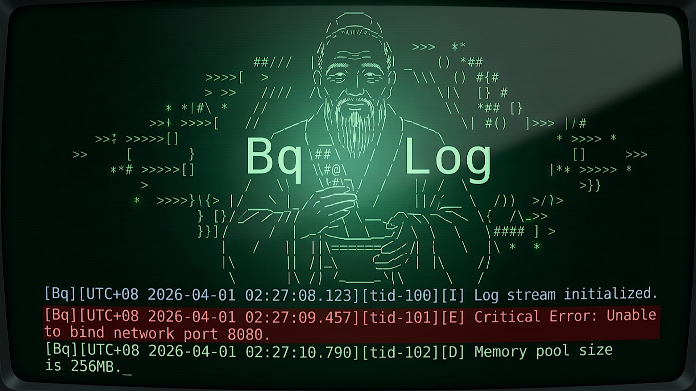

# BqLog Python Wrapper

High-performance Python logging powered by [BqLog](https://github.com/Tencent/BqLog).

## Requirements

- Python 3.7+
- Windows / macOS / Linux

## Installation

```bash
pip install bqlog
```

## Quick Start

```python
from bq.log import log

my_log = log.create_log("my_log",
    "appenders_config.ConsoleAppender.type=console\n"
    "appenders_config.ConsoleAppender.time_zone=localtime\n"
    "appenders_config.ConsoleAppender.levels=[all]\n"
    "log.thread_mode=sync")

my_log.info("Hello from BqLog! params: {}, {}", "text", 123)
log.force_flush_all_logs()
```

## API Reference

See the main [BqLog README](https://github.com/Tencent/BqLog) for full documentation.

## License

Apache License 2.0
